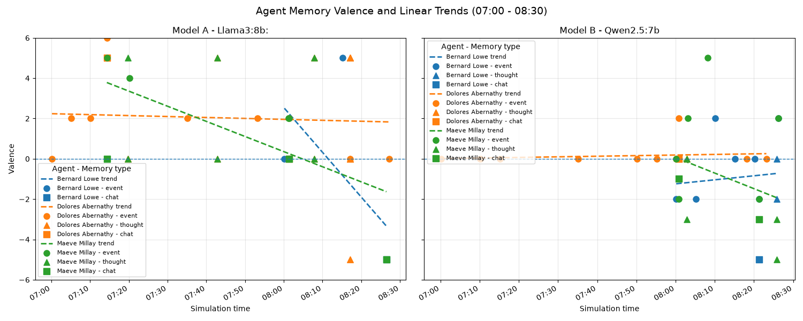

# Case Study 4: Answer Template

**Student name(s): Kaya de Jong, Tim Verberne**

**Student number(s): sxxxxxxx, s4080084**

**Date:**

**Models used:** Model A: Llama3:8b | Model B: Qwen2.5:7b

---

## Exercise 1: Shaping Agent Personalities

### 1.1 Version 1

**Prompting style used** (e.g., adjectives only, full sentences, concrete examples):

**`innate` field:**

> `"bossy, prideful"`

**`learned` field:**

> `"Bernard is the boss at Hobbs Cafe. He tries to manage the cafe perfectly and monitors how his baristas work. If he finds them doing something wrong, he confronts them about it. Dolores and Maeve are both baristas that work under him. He keeps interactions at work task-oriented. After Bernard gets home, he buys things online needed for the cafe"`

**Sample conversation excerpts (2–3):**

> 1. `"Alright, let's get the cafe open. I'll start prepping the coffee machines and you can get the seating area ready. We've got a lot of customers to serve today."`
> 2. `"Alright, let's get started then. I'll make sure to keep an eye on the cafe's inventory and make sure we're well-stocked for the lunch rush. How's the seating area looking?"`
> 3. `"Let's make sure to keep the cafe clean and tidy throughout the day, okay? We don't want any messes or spills to slow us down during the lunch rush."`

### 1.2 Version 2

**Prompting style used:**

**`innate` field:**

> `"impatient, prideful, demanding"`

**`learned` field:**

> `"Bernard is the manager of Hobbs Cafe and he always at the cafe on 8am. He tries to manage the cafe perfectly and monitors how his baristas work. When an employee takes too long to complete a task, he says things like 'How are you not done yet? This should have been finished already.' Whenever the cafe is quiet, he tells his employees, 'Why are you standing around? We should be preparing for the next customers.' He frequently checks on his employees' progress and rarely compliments them."`

**Sample conversation excerpts (2–3):**

> 1. `"Morning, Maeve. Good to see you're getting ready for the day. I'll make sure to have everything set up and ready to go by the time you and Dolores get here."`
> 2. `"I'll be keeping an eye on things while you and Dolores get settled. Let me know if you need anything."`
> 3. `"Great, I'll make sure to have everything ready to go. Let's get started on the morning rush, shall we?"`

### 1.3 Version 3

**Prompting style used:**

**`innate` field:**

> `"impatient, arrogant, confrontational, short-tempered, demanding"`

**`learned` field:**

> `"Bernard is the manager of Hobbs Cafe and believes his employees are incompetent unless he constantly supervises them. He tries to manage the cafe perfectly and monitors how his baristas work. If they are not working around his standards, he will let them know how it should be improved. When he sees one of his employees, he approaches them to inspect their work. He often interrupts employees when they try to explain themselves and demands immediate improvements. He rarely apologizes or praises anyone. Bernard tries to open the cafe around 8 am."`

**Sample conversation excerpts (2–3):**

> 1. `"Look, Maeve, I don't have time for small talk. Just get to work and make sure the cafe is running smoothly."`
> 2. `"Look, Maeve, I don't have time to babysit you. Just get the cafe ready and let's get started already."`
> 3. `"Maeve, what's taking you so long? We need to get the cafe customer seating ready for the morning rush. Make sure everything is spotless and organized."`

### 1.4 Analysis

**Which version produced the most confrontational Bernard? Which produced the least?**

Your answer: Version 3 definately produced the most confrontational Bernard. As for the least confrontational, version 1 and version 2 are relatively close togheter. Both version 1 and version 2 are not mean, version 1 is probably a bit more direct, where version 2 is actually quite helpfull. So version 2 is the leat confrontational Bernard.

**Does Bernard's actual behaviour match what you wrote? Where is the gap largest?**

Your answer:

The largest gap between the intended personality and the observed behaviour is in version 2. Here we told him to be `"impatient, prideful, demanding"` and gave some examples of how that could look like. However, Bernard comes accross very patient, understanding and helpfull in his responses.

In version 1 there is a relatively good match between what was asked and what Bernard did. He was described as `"bossy, prideful"` and we see that he keeps reminding his employees to keep the cafe running smoothly.

In version 3 there is also a good match between what was asked and what Bernard portraied. However, here we also see the actual confrontational side of the character, with him being dismissive, impatient and controlling towards the employees.

**Which prompting style was most effective at overriding the LLM's tendency to be polite? Why do you think that is?**

Your answer:

Version 3 was the most effective prompting style for overriding the LLM's tendency to be polite. This is likely due to more and stronger adjatives that were used in the innate field. Combined with a list of how he should behave in certain situations in the learned field.

---

## Exercise 2: Comparing Models

### 2.1 Models used

- Model A: Llama3:8b
- Model B: Qwen2.5:7b

**Which Bernard personality did you use (from Exercise 1)?**

We used the most confrontational verson of Bernard, our version 3 from Exercise 1.

### 2.2 Qualitative comparison

**Do the agents sound different across models? Describe the differences in tone, vocabulary, and interaction style. Provide at least one conversation excerpt from each model.**

Llama3:8b excerpt:

1. `Maeve: "I'm just going to start getting ready for work, I want to make sure I have everything I need before we get busy. Would you like to grab a cup of coffee with me before we start our shifts?"              Dolores: "Sounds like a plan, Maeve! I'm ready to tackle the morning rush with you. Let's make sure we're both energized and focused before we start taking orders."`
2. `Maeve: "Hi, Bernard. I was hoping for a normal day today. Dolores and I are planning to work together to get through the morning rush. Would you like to grab a cup of coffee with us before we start our shifts?" Bernard: "What's this about a normal day? I don't pay you to socialize, I pay you to make coffee. Let's get to work."`
3. `Maeve: "I understand, Bernard. I just think it would be helpful to have a clear plan in place for the morning rush. Dolores and I have been working together well, and I think we could make a big difference if we're coordinated. Would you be open to discussing a plan with us?"     Bernard: "What's this plan you're talking about? I'm the one who knows how to run this cafe, not you and Dolores. Just get to work and follow my instructions."`

Qwen2.5:7b excerpt:

1. `Dolores: "Good morning, Maeve! Are you just waking up? I'm heading to Hobbs Cafe. Want to join me?"                                       Maeve: "Good morning, Dolores! I'm just getting started. Maybe I'll catch you later at the cafe?"`
2. `Bernard: "Good, I don't want any surprises. Let's make sure everything runs smoothly today. Keep an eye on the coffee machines and the customer flow. I'll be around to check in."                                    Maeve: "Of course, Bernard. I'll keep a close eye on everything. I appreciate the support and feedback."`
3. `Bernard: "Maeve, if you need any assistance, just let me know. I'll be around to help if needed, but I expect everything to be perfect today." Maeve: "Absolutely, Bernard. I'll make sure everything is flawless today. I'll start with the first batch of coffee and then move on to serving customers. See you around!"`

Your analysis:

If we look at the interactions between Dolores and Maeve, we see that they are mostly simillar in terms of how they act to oneanother. The tone is very friendly and positive for both modes. The Llama model does use a bit more words for each scentence, which is something we see for all agents, but the overall behaviour is similar.

Looking at the conversations from Bernard in the two models, we see a clear distinction. In the Llama model Bernard comes accross as a very grumpy and annoyed boss, as shown by the vocabulary used in the excerpts. The tone is very negative, as was intended by how his innate and learned field were prompted. However, with the Qwen model he comes accorss as a strickt boss, but not mean, he is much more constructive and understanding with the words that are used. The tone is much less negative, and the asscribed personallity in the innate and learned fields come accross less good.

### 2.3 Valence comparison

(Attach or paste your valence trajectory plot)

**Which model produces more emotional variance?**

Your answer:

The variance plot shows an interesting difference. Before the restaurant opens, the agents in the Llama model show overal high, positive valance. However, once the restaurant opens, this drops for all agents and the overall valance is going down signifianctly, especially for Bernard and Maeve. For the Qwen model the valance is a bit closer centered around zero, with less extreme values, compared to the Llama model. For the Qwen model there is not much data on before the restaurant opens, however at least for Maeve the valance seems to go down once the restaurant opens. The valance of Dolores stase relatively constant for both models, however for Llama it's about 2 points more positive compared to Qwen.

### 2.4 JSON validation failures

|                    | Llama3:8b | Qwen2.5:7b |
| ------------------ | --------- | ---------- |
| Total LLM calls    | 968       | 538        |
| Failed validations | 119       | 4          |
| Failure rate       | 12.29 %   | 0.74 %     |

**What does this tell you about using different models in agent simulations?**

Your answer:

This results shows that there is a large difference regarding the models in terms of agent simulation. This was a difference that was also noticable in runtime. A model wich has a high failure rate, i.e. more failed validations, runs longer than a model with a low failure rate. This is important for the computation cost, both in terms of time and the actual cost of running the model.

### 2.5 Reflection

**The architecture and personality descriptions are identical. What does it mean that behaviour differs anyway?**

Your answer:

That behaviour differes regardless of identical architecture and personality descriptions, shows that that the model used still has a significant influence on the outcome of a simulation. This means that when results are stated, it must also always be stated which model was used and noted that the results are thus only for said specific model.

---

## Exercise 3: Enabling the Negativity Bias

The negativity bias consists of two mechanisms:

- **Valence-weighted retrieval:** The standard architecture retrieves memories based on recency, relevance, and importance only (the valence weight is set to zero). To enable valence-aware retrieval, the agent needs a non-zero valence weight. The negativity bias multiplier controls how much more strongly negative memories are favoured over positive ones during retrieval — a value of 1.5 means negative memories are retrieved 1.5× more readily.
- **Asymmetric sensory encoding:** When enabled, negatively valenced events (≤ −3 on a −10 to +10 scale) are stored with expanded perceptual detail (richer descriptions of what the agent expereinced). When disabled, all events are stored with the same level of detail regardless of valence.

  Look at Dolores's `scratch.json` file. Find the fields that control these mechanisms and set them appropriately. Maeve's scratch file should remain unchanged — she is your control.

**Which Bernard personality did you use (from Exercise 1, the one you used in Exercise 2)? Paste his `innate` and `learned` fields.**

Your answer:

### 3.1 Valence trajectories

(Attach or paste your plot of Dolores vs Maeve valence over time)

### 3.2 Descriptive statistics

| Agent               | Overall valence | Thought valence |
| ------------------- | --------------- | --------------- |
| Dolores (neg. bias) |                 |                 |
| Maeve (control)     |                 |                 |

**Cohen's d:**

**Interpretation (small / medium / large effect):**

### 3.3 Thought description comparison

**Dolores example thought (negative memory):**

**Maeve example thought (comparable event):**

**Is Dolores's description longer and more sensorially detailed?**

Your answer:

### 3.4 Memory intrusion check

If your simulation included off-duty hours, answer the following. If not, write "Simulation was too short to observe off-duty reflections."

**Did you find work-related content in Dolores's evening reflections? Paste any examples:**

**Did you find work-related content in Maeve's evening reflections? Paste any examples:**

**Is there a difference between the two agents?**

Your answer:

### 3.5 Consistency across runs (if applicable)

| Run   | Dolores valence | Maeve valence | Cohen's d |
| ----- | --------------- | ------------- | --------- |
| Run 1 |                 |               |           |
| Run 2 |                 |               |           |
| Run 3 |                 |               |           |

### 3.6 Tracing the mechanism

**You enabled two changes: negative memories get higher retrieval scores, and negative events get stored with more detail. Looking at your logs, can you trace how these two changes could lead to the valence decline you observed? Think about what happens when a negatively-toned reflection gets stored as a new memory.**

Your answer:

---

## Exercise 4: Daily Plan Quality

### 4.1 Original plan problems

**Paste an example of a problematic daily plan and annotate what is wrong with it:**

### 4.2 Your planning rules

List the rules you wrote:

### 4.3 Improved plan

**Paste an example of a daily plan generated with your rules:**

### 4.4 Downstream effects

**Do agents with better plans behave differently? More social interactions? Different valence patterns?**

Your answer:

---

## General Reflection

**What was the most surprising finding across all exercises?**

Your answer:

**If you were designing an agent simulation for a real application, what would you do differently based on what you learned?**

Your answer:
